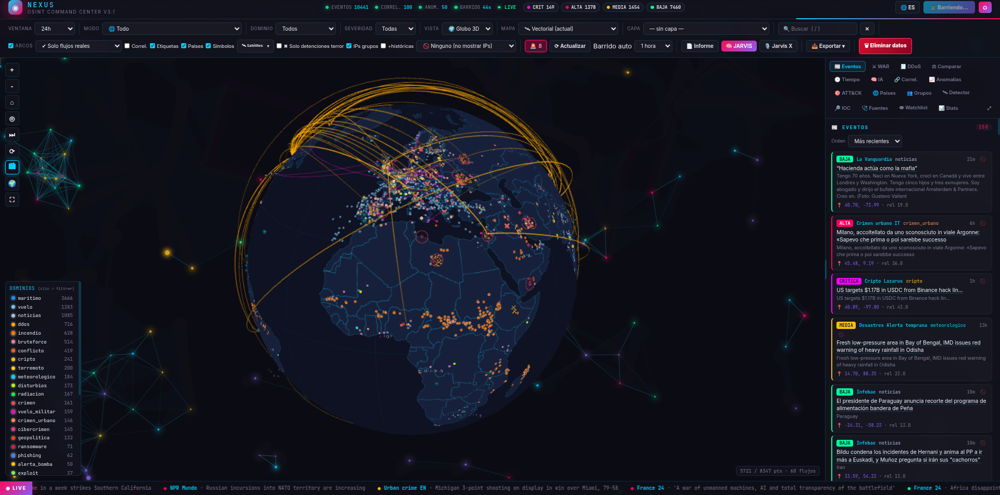
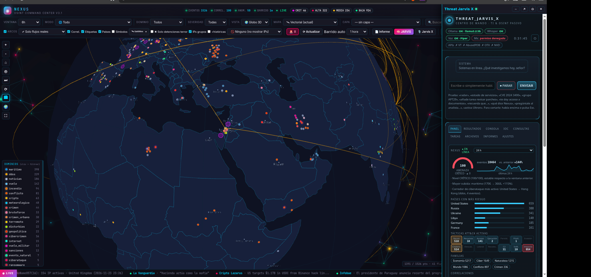
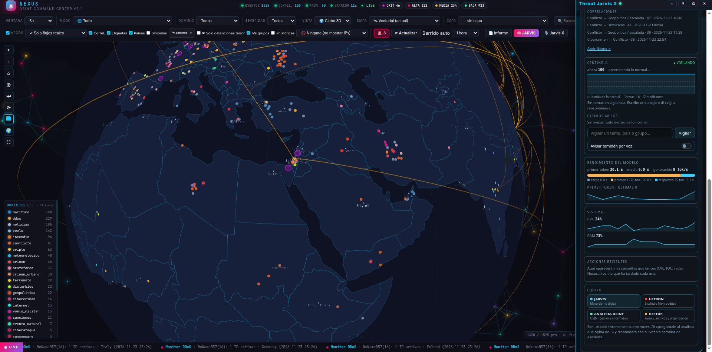

# Nexus_Osint_X · Command Center v3.1


> **Radar OSINT autohospedado**: más de 330 entradas de fuentes públicas (RSS, APIs, listas de IPs, canales públicos de Telegram), globo 3D con deck.gl, satélites, correlación entre dominios, MITRE ATT&CK, panel J.A.R.V.I.S, detector de denuncias y bot de Telegram (⚠️ sin probar). **Es un prototipo y puede dar falsos positivos: léelo como una pista, no como una prueba.** Todo en un único `Nexus_Osint_X.py` ejecutable con `python Nexus_Osint_X.py` o `uvicorn`.



[](https://www.python.org/)
[](https://fastapi.tiangolo.com/)
[](https://www.uvicorn.org/)
[](https://www.sqlite.org/)
[](https://jinja.palletsprojects.com/)
[](https://developer.mozilla.org/en-US/docs/Web/API/WebSockets_API)
[](https://jwt.io/)
[](https://deck.gl/)
[](https://www.chartjs.org/)
[](https://pandas.pydata.org/)
[](https://numpy.org/)
[](https://www.python-httpx.org/)
[](https://apscheduler.readthedocs.io/)
[](https://attack.mitre.org/)
[](https://en.wikipedia.org/wiki/Open-source_intelligence)
[](https://en.wikipedia.org/wiki/Cyber_threat_intelligence)
[](https://github.com/Condor2026/Nexus_Osint_X)
[](https://github.com/Condor2026/Nexus_Osint_X)
[](#-estado-del-proyecto-prototipo)
[](#-falsos-positivos-y-limitaciones)
[](./LICENSE)
[](./CONTRIBUTING.md)
[](https://github.com/Condor2026/Nexus_Osint_X/commits/main)
[](https://github.com/Condor2026/Nexus_Osint_X)
[](https://github.com/Condor2026/Nexus_Osint_X/stargazers)
[](https://github.com/Condor2026/Nexus_Osint_X/network/members)
[](https://github.com/Condor2026/Nexus_Osint_X/issues)

**Topics:** `osint` · `threat-intelligence` · `cybersecurity` · `dashboard` · `deck-gl` · `mitre-attack` · `cti` · `defensive-security` · `fastapi` · `python` · `globe` · `3d-visualization` · `sqlite` · `ioc` · `threat-hunting` · `security-tools` · `open-source-intelligence` · `cyber-threat-intelligence` · `self-hosted`


---

## 🧩 Ecosistema Nexus · cada herramienta en su casa

Nexus_Osint_X no está solo. Forma parte de un conjunto de **herramientas independientes**, cada una con su propio repositorio y su propia función. Puedes usar cualquiera por separado; no necesitan estar todas en marcha a la vez.

| Herramienta | Rol | Repositorio | Estado |
|---|---|---|---|
| **Nexus_Osint_X** (este repo) | **Radar / base de mando OSINT**: agrega 330+ fuentes, correlaciona, mapa 3D, ATT&CK, panel JARVIS | `Condor2026/Nexus_Osint_X` | Prototipo funcional (v3.1) |
| **OsintCiberCrimeX** | **Buscador potenciado y específico** de crimen y cyber: índice propio + scraping pasivo + búsqueda especializada | `Condor2026/OsintCiberCrimeX` | v1.15.0 funcional · release ampliada dic 2026 |
| **ThreatJarvisX** | **Asistente IA** que consulta Nexus por su API | repositorio propio | Activo |
| **Puente_Nexus** (en este repo) | **Enlace** OsintCiberCrimeX ↔ Nexus: lanza, vigila y sincroniza IOCs | `Condor2026/Nexus_Osint_X` | v1.1 funcional |

**La diferencia importante:**

- **Nexus es un radar**: observa lo que pasa, agrega eventos de 330+ fuentes, correlaciona, dibuja en el mapa. **No busca por ti**; te muestra el panorama.
- **OsintCiberCrimeX es un buscador**: tú preguntas por un grupo, una IP, un CVE, un canal o un patrón, y él busca en su índice especializado. El scraping es **cómo se alimenta**, no lo que es.

**Cómo encaja todo:**

```
┌───────────────────┐        ┌──────────────────┐        ┌─────────────────┐
│ OsintCiberCrimeX  │  IOCs  │  Puente_Nexus    │ watch  │  Nexus_Osint_X  │
│   (buscador)      │ ─────► │  (este repo)     │ ─────► │  (radar/mando)  │
└───────────────────┘        └──────────────────┘        └─────────────────┘
                                                                  ▲
                                                                  │ API HTTP
                                                           ┌──────┴───────┐
                                                           │ ThreatJarvisX │
                                                           │  (asistente)  │
                                                           └───────────────┘
```
## 🌉 ¿Cómo funciona el Puente_Nexus?

El **Puente_Nexus** es un proceso independiente que conecta **OsintCiberCrimeX** (buscador) con **Nexus_Osint_X** (radar). **No modifica** ninguno de los dos: los lanza, los vigila y los hace hablar por sus APIs HTTP locales.

### En 4 pasos

1. **Detecta** dónde está cada herramienta (puertos 8765 y 8000; si Nexus está en otro, lo busca).
2. **Lee IOCs** de OsintCiberCrimeX (`/api/iocs`: IPs, C2, CVE) y los grupos más citados.
3. **Los copia** a la watchlist de Nexus (`/api/watchlist/add`), que a partir de ahí etiqueta y sube de severidad los eventos del mapa que coincidan.
4. **Cruza** los eventos recientes de Nexus (`/api/events`, `/api/group_ips`) con los IOCs del buscador y muestra **coincidencias** en su panel (`:8800`).

### Reglas

- **Solo añade lo que él mismo añadió** a la watchlist. Lo que pongas tú a mano, no lo toca.
- **Todo queda registrado** en `puente_estado.json` y se puede **retirar** desde el panel.
- **Una coincidencia no es una prueba**: es una pista para que abras el evento en Nexus y el mensaje original en OsintCiberCrimeX.
- **Funciona solo con stdlib**: no instala nada extra.

### Arranque

```bash
python Puente_Nexus.py --all     # lanza OsintCiberCrimeX + Nexus + panel del puente (agrega el puerto que te conseja el puente en Osintcrime)
python Puente_Nexus.py --sync    # una sincronización y sale
python Puente_Nexus.py --status  # estado de las dos herramientas

```

- **Nexus_Osint_X** funciona **solo**, sin nada más. Es el radar.
- **OsintCiberCrimeX** funciona **solo**, sin Nexus. Es el buscador.
- **Puente_Nexus** es un *extra* incluido aquí porque es lo que conecta este repo con OsintCiberCrimeX. Sin el puente, las dos herramientas simplemente no se hablan (lo cual es perfectamente válido).
- **ThreatJarvisX** vive en su propio repo y consulta a Nexus por la API (`/api/kpis`, `/api/analytics`, `/api/crypto`…). No se publica aquí.

> **Este repo solo contiene Nexus_Osint_X + el puente.** OsintCiberCrimeX y ThreatJarvisX tienen su propio lugar y se publican por separado. No se mezclan los códigos.




## ⚠️ Descargo de responsabilidad

- Todos los indicadores (IPs, dominios, hashes) provienen de **fuentes públicas**: CERTs oficiales (GovCERT.ch, CISA), prensa, canales públicos de Telegram, APIs públicas (abuse.ch, Cloudflare Radar, FBI, INTERPOL).
- **Sin verificación independiente.** La atribución a grupos es lo que dicen las fuentes públicas, no una conclusión forense.
- **Uso permitido:** investigación defensiva, threat intelligence, educación, SOC.
- **Uso prohibido:** ataques activos, escaneos no autorizados, acciones legales basadas en estos datos, acoso a personas.
- Los nombres de grupos son **públicos y documentados** por CERTs y prensa (Killnet, NoName057(16), Lazarus, APT28…). No son acusaciones privadas.
- Si eres titular de una IP listada y crees que es un error, abre un issue y se revisa.
- **Este es un prototipo.** No todas las partes están igual de maduras (ver "Estado del proyecto"). Lo que no funciona, se irá arreglando.
- **Puede dar falsos positivos (y falsos negativos).** Una alerta, un punto en el mapa, una correlación o la IP de un grupo son **pistas automáticas**, no hechos confirmados. Lee la sección [Falsos positivos y limitaciones](#-falsos-positivos-y-limitaciones) antes de fiarte de cualquier dato.
- **No tomes decisiones graves (legales, laborales, de seguridad física o de represalia) basándote solo en lo que muestra Nexus_Osint_X.** Contrasta siempre con la fuente original (cada evento lleva su enlace).

### Lo que Nexus_Osint_X NO hace

- ❌ No escanea puertos ni hosts.
- ❌ No explota vulnerabilidades.
- ❌ No contacta con C2 ni con infraestructura maliciosa.
- ❌ No envía tráfico a los indicadores que muestra (las URLs van defangeadas: `hxxp://ejemplo[.]com`).
- ❌ No simula ataques ni genera escenarios hipotéticos.
- ❌ No predice el futuro (la «tendencia» de JARVIS es una extrapolación lineal simple del intervalo anterior, no una predicción fiable).
- ❌ No reemplaza a un SOC, un CTI o un analista humano.
- ❌ No verifica independientemente las atribuciones: refleja lo que dice la fuente.

**Nexus_Osint_X es un radar, no un simulador.** Si buscas un war-game o un generador de escenarios, esta no es tu herramienta.


## 🚧 Estado del proyecto: prototipo

Nexus_Osint_X es un **prototipo funcional**, hecho con el tiempo y los medios disponibles. **Hice todo lo que pude** con lo que tenía, priorizando que el núcleo (recolección, mapa, correlación, export) funcionara antes que los extras.

**Qué significa «prototipo» aquí, sin adornos:**

- Está pensado para **investigar, aprender y como radar de apoyo**, no como sistema de producción ni como fuente única de verdad.
- **No se ha probado contra todos los endpoints reales** a la vez: muchas fuentes se han desarrollado contra respuestas de ejemplo y pueden fallar, cambiar de formato o bloquearte desde tu red/IP. Por eso hay circuit breaker, fallbacks y la pestaña **🩺 Fuentes**.
- El **render 3D del globo con mapas base (teselas)** depende de tu navegador/GPU y de la versión de deck.gl que cargue desde CDN. Puede haber artefactos visuales según el equipo. Si algo se ve raro, prueba la vista **Plano** o cambia el mapa base.
- No hay suite de tests automatizados completa ni auditoría de seguridad formal.
- Es un **único archivo** (`Nexus_Osint_X.py`, ~15 000 líneas) por decisión de diseño: fácil de copiar y ejecutar, incómodo de mantener. Es lo que hay.

| Componente | Estado | Notas |
|---|---|---|
| Recolección de fuentes (>330 entradas, ~200 de prensa) | ✅ Funciona (con matices) | Barrido automático (15 min por defecto) + carril rápido de prensa (4 min) + carril rápido de denuncias (5 min). **Algunas fuentes fallan según red/IP/cuota** (ver 🩺 Fuentes). Fuentes lentas (GDELT) siguen en segundo plano y se incorporan al terminar |
| Globo 3D / mapa plano (deck.gl) | ✅ Funciona | Instancia única en la página, sin iframe. Mapas base sin clave en 3D y plano. Fallback 2D con Canvas si no hay WebGL/deck.gl. **Visual 3D con teselas poco probado en hardware variado** |
| Satélites (órbitas) | 🟡 En pruebas | Posiciones calculadas a partir de TLE públicos; precisión de kilómetros, no para navegación ni seguimiento operativo |
| Correlación, anomalías, ATT&CK | ✅ Funciona | Scoring ponderado + decaimiento temporal + entidades compartidas. **Las correlaciones son coincidencias, no causas** |
| Panel JARVIS | ✅ Funciona | Índice de amenaza, radar ATT&CK, KPIs, salud de fuentes, correlaciones en vivo, tendencia, movimiento militar, comparar con antes, fichas, resumen en texto, alarmas con sonido, buscador de IP, cripto |
| Export (12 formatos) | ✅ Funciona | CSV, JSON, NDJSON, GeoJSON, KML, XLSX, Markdown, HTML, lista de IPs, IPs de grupos (CSV/JSON), ZIP |
| Detector de denuncias (Telegram + RSS) | 🟡 En pruebas | Lectura **pasiva** de canales públicos `t.me/s/` (sin login, sin cuenta). Puede fallar si Telegram limita (429), si un canal cambia de formato o si no tiene vista web pública |
| Monitor DDoS (listas vivas) | 🟡 En pruebas | IPs frescas de listas vivas + ThreatFox + rangos CIDR de NoName057(16); solo se guardan las que coinciden con un grupo, con retención |
| **Bot de Telegram** | ⚠️ **Sin probar** | **No se sabe si funciona.** El código está, pero no se ha ejecutado de principio a fin. **Se arreglará otro día.** |
| LLM (resumen) | 🟡 Opcional | Requiere `OPENAI_API_KEY`; sin ella, devuelve "no disponible" |
| **Puente_Nexus** (enlace con OsintCrime) | ✅ v1.1 | Lanza, vigila y sincroniza Nexus ↔ OsintCrime por API local. Ver [sección del puente](#-puente_nexus--enlace-con-osintcrime) |
| War-gaming / simulación | ❌ No existe | No está previsto (ver Filosofía) |

**Sobre el bot de Telegram:** el código está escrito, pero **no se ha probado**. No sé si arranca, si los comandos responden o si el polling falla. **No lo uses como canal de alertas en producción.** Mientras tanto, el resto del sistema funciona sin él: si no defines `TELEGRAM_BOT_TOKEN`, el bot simplemente no arranca y todo lo demás sigue igual.

**Sobre las vulnerabilidades:** hice lo que pude con lo que sé. Las mitigaciones aplicadas están en la sección "Seguridad" de abajo. No es una auditoría formal; si encuentras algo, abre un aviso privado (ver `SECURITY.md`).

---

## 🎯 Falsos positivos y limitaciones

**Nexus_Osint_X puede equivocarse.** Agrega y clasifica texto público de forma automática; no entiende el contexto como una persona. Trata cada elemento como una **pista que hay que verificar** en la fuente original.

### Por qué aparecen falsos positivos

| Origen | Qué puede pasar |
|---|---|
| **Palabras clave** | La severidad, el dominio (terrorismo, crimen, conflicto…), el tipo de ataque y los grupos se deducen por palabras clave. Un titular que *habla de* un atentado (análisis, aniversario, serie, simulacro, opinión) puede clasificarse como si fuera uno nuevo. Ironía, citas y negaciones se interpretan mal. |
| **Ubicación inferida del texto** | Si el texto nombra un país o ciudad, el punto va ahí, aunque el evento ocurriera en otro sitio (p. ej. «el presidente de X condena el ataque en Y»). Homónimos (ciudades con el mismo nombre) y nombres de medios que contienen un lugar también pueden confundirlo. Las coordenadas de país/ciudad son **centroides aproximados** con un pequeño desplazamiento determinista para no apilar puntos: **no son la dirección real del suceso**. |
| **Fuentes de solo titular** | Algunas fuentes de prensa llegan por Google News RSS (respaldo cuando el feed directo falla): solo hay titular y enlace, sin cuerpo. Menos contexto → más errores de clasificación. |
| **Duplicados y ecos** | El dedupe (SimHash) reduce repeticiones, pero la misma noticia en varios medios puede contar varias veces y **inflar** contadores, tendencias y el índice de amenaza. |
| **Correlaciones** | Agrupa eventos de dominios distintos cercanos en espacio y tiempo (ventana de 360 min por defecto, `NEXUS_CORR_WINDOW_MIN`). **Coincidir no significa estar relacionados.** En ciudades grandes o zonas con mucha prensa saldrán «correlaciones» casuales. La ficha indica si comparten algo real (IP/CVE) o solo lugar y hora. |
| **IPs de grupos** | Las listas públicas (y los mensajes de Telegram) mezclan **atacantes, víctimas, proxies, nodos Tor/VPN, IPs compartidas y reutilizadas**. Que una IP aparezca asociada a un grupo **no prueba** que sea suya ni que ahora lo siga siendo (las IPs cambian de dueño). Por eso las no verificadas se marcan como «reportada». |
| **Atribuciones a grupos** | Es lo que dice la fuente (prensa, canal de Telegram, CERT). Los grupos hacktivistas **exageran y mienten** a menudo, y la prensa repite sin verificar. No es una conclusión forense. |
| **Canales de Telegram** | Cualquiera puede publicar cualquier cosa. Los canales pueden reclamar ataques que no hicieron, reciclar imágenes o publicar propaganda. |
| **Satélites** | Posición calculada de TLE públicos: error de kilómetros y más con TLE viejos. Sin propietario/país fiable en el TLE. Un nombre parecido no implica función militar. |
| **Aviones y barcos «militares»** | La etiqueta «militar» sale de listas y heurísticas públicas (hex ICAO, nombres, categoría). Puede haber civiles marcados como militares y militares sin marcar; muchos aparatos **no emiten** o lo hacen con retraso. |
| **Tendencia / «próximo intervalo»** | Es una recta ajustada a unos pocos intervalos recientes. Sirve para ver hacia dónde apunta la curva, no para anticipar nada. |
| **Comparaciones («vs. antes»)** | Si cambian las fuentes disponibles (caídas, bloqueos, circuit breaker abierto), el contador baja o sube **sin que el mundo haya cambiado**. Mira **🩺 Salud de fuentes** antes de interpretar una bajada. |
| **Datos antiguos o incompletos** | Eventos viejos conservan el formato/descripcion con el que se guardaron. Los barridos pueden quedarse a medias si una fuente tarda. |
| **Lo que añade el puente a la watchlist** | El puente copia IOCs de OsintCrime a la watchlist de Nexus. Si OsintCrime marca una IP como C2 y en realidad era una víctima, Nexus la subirá de severidad en eventos que la mencionen. El puente registra cada cosa que añade en `puente_estado.json` y permite **retirarla** sin tocar lo que pusiste tú. |

### Falsos negativos (lo que NO ves)

- Eventos **sin país/ciudad reconocible** en el texto se descartan del mapa (no se inventan coordenadas).
- Fuentes caídas, bloqueadas, sin clave o con cuota agotada **no aportan nada**: la ausencia de alertas **no significa que no pase nada**.
- Cobertura desigual: más fuentes en inglés/español/europeas que en otras regiones e idiomas.
- Lo que no se publica abiertamente (inteligencia privada, redes cerradas, canales de Telegram sin vista web pública) **no aparece**.

### Qué hacer para reducir errores

1. **Abre siempre el enlace original** del evento y léelo antes de concluir nada.
2. **Cruza** con al menos otra fuente independiente.
3. Revisa **🩺 Fuentes** (qué está caído, qué falta clave) antes de interpretar una subida o bajada.
4. Usa los **filtros** de dominio/severidad/grupo y el **marcado de falsos positivos** (`/api/fp`) y los **silencios temporales** (`/api/mute`) para limpiar ruido recurrente.
5. Para una IP concreta usa el **Buscador de IP** y recuerda: salir en una lista **no significa que seas la víctima ni el atacante**; puede ser un dispositivo comprometido, un NAT compartido o una IP reasignada.
6. **No publiques ni actúes** contra personas u organizaciones por lo que ves aquí sin verificarlo por tu cuenta.

### Limitaciones técnicas conocidas

- Algunas fuentes pueden **fallar o ir lentas según tu red** (bloqueos 403/429, DNS, geoblocking). El sistema degrada solo: reintenta, usa respaldos (p. ej. Google News `site:`) y abre circuit breaker, pero no puede garantizar cobertura.
- **GDELT** limita las consultas (429); Nexus usa caché, espaciado entre peticiones y pausa tras un 429, así que sus datos llegan con retraso.
- **Rate limits** de geolocalización (`ip-api.com`, 15 req/min sin `GeoLite2`): las IPs pueden tardar en ubicarse.
- Las URLs de **CDN** (deck.gl, teselas de mapa) deben ser accesibles desde tu navegador; si no, se usa el mapa 2D de reserva.
- La ventana de datos y la retención son finitas (`NEXUS_RETENTION_DAYS`).

---

## ✨ Qué hace

- **Más de 330 entradas de fuentes OSINT** (≈200 de prensa mundial; el resto APIs, feeds y listas): ciberataques (DDoS, malware/botnets, fuerza bruta, exploits, ransomware, phishing), MITRE ATT&CK, cibercrimen, crimen mundial/urbano, terrorismo, detenciones, amenazas de bomba, conflictos, disturbios, caídas de servicios, naturaleza, salud, economía, sanciones, **FBI Wanted e INTERPOL Red Notices**, **cripto**, **prensa mundial** y búsquedas de disturbios en varios idiomas.
- **Globo 3D y plano** con `deck.gl` en la propia página (sin iframe) + red neuronal animada de fondo.
- **Mapas base sin clave**: Carto (oscuro / claro / voyager) y Esri (gris oscuro / satélite), tanto en el plano como sobre el globo 3D. Sin teselas, esfera oscura de reserva.
- **Satélites**: capa de satélites con órbita y **ficha** por satélite (a partir de TLE públicos).
- **Arcos reales** atacante→víctima solo cuando ambos extremos son conocidos (Cloudflare Radar, noticias atribuidas, feeds de grupos). Sin dos extremos, no hay arco.
- **Fichas** de eventos, aviones, barcos y satélites con enlace a la fuente original.
- **Modos temáticos**, ranking de riesgo por país y buscador de IOC.
- **SQLite** con histórico, clustering espacial y retención automática (`NEXUS_RETENTION_DAYS`, 120 días por defecto). La intel de cibercrimen **no se purga nunca** (`NEXUS_KEEP_CYBER=important|all|off`).
- **Correlación** con scoring ponderado, decaimiento temporal y entidades compartidas.
- **Detección de anomalías**: z-score por dominio, entidades nuevas, ráfagas CRÍTICA, sentimiento negativo.
- **Enriquecimiento**: dedupe semántico (SimHash), escalado de severidad, watchlist persistente, tendencias por dominio, búsqueda facetada.
- **Auth** JWT + HTTP Basic + bypass de loopback (`NEXUS_LOCAL_NOAUTH=1` por defecto, solo desde 127.0.0.1 sin proxy y con validación de `Host`/`Origin`/`Sec-Fetch-Site`).
- **Circuit breaker** por fuente: 5 fallos seguidos → pausada 5 min. Respaldos automáticos (p. ej. Google News `site:` si un feed RSS directo falla) y cliente GDELT con caché, cabeceras de navegador, espaciado y pausa tras 429.
- **WebSocket** para actualizaciones en vivo.
- **Export** en 12 formatos.
- **Bot de Telegram** ⚠️ **sin probar** (ver "Estado del proyecto").
- **LLM opcional** con 3 prompts y caché (si defines `OPENAI_API_KEY`).
- **Scheduler** con health monitoring por fuente, retención automática y watchlist persistente.
- **Detector de denuncias** que recorre canales públicos de Telegram (`t.me/s/…`, **solo lectura pasiva, sin login**), feeds de seguridad y el monitor DDoS, y guarda cada detección (aunque no se pueda ubicar) en la pestaña «🛰 Detector».
- **Buscador de IP** en JARVIS: busca una IP en eventos, listas de grupos y detecciones; avisa si es tu IP pública (`📡 Mi IP pública`).
- **Criptomonedas** (top 10 vía CoinGecko → CoinPaprika) en JARVIS.
- **Alarmas con sonido opcional** (🔔) para eventos críticos nuevos.
- **Falsos positivos manejables**: marcar un evento como falso positivo y **silenciar** temporalmente una fuente/grupo/término.
- **Anti falsos positivos en el detector**: descarta noticias que *hablan* de un grupo (atribuciones, «según investigadores…») y ataques de un grupo a su aliado. *Reduce* el ruido; no lo elimina.
- **Claves en el código (`CLAVES`)**: si no usas `.env`, puedes pegar tus claves en el diccionario `CLAVES` al principio de `Nexus_Osint_X.py`.
- **«Eliminar datos»** con modal de confirmación `BORRAR`; **nunca** toca la intel de cibercrimen, IPs de grupos, detecciones, caché de geolocalización, ajustes ni auditoría.
- **Botón «⏻ Apagar»** que cierra NEXUS y libera el puerto.
- **Idioma ES/EN** (`🌐 ES/EN`), guardado en `localStorage`.
- **Nombres de ciudades** (`🏙`), graticule, arcos con `GreatCircleLayer`/`ArcLayer`, `ScatterplotLayer` para IPs de grupos (cuadrado = IP única), correlaciones en magenta y ficha de evento con enlace al original.
- **Compatible con el ecosistema**: el **Puente_Nexus** (incluido aquí) puede sincronizar la watchlist desde OsintCrime y cruzar IOCs; **ThreatJarvisX** (repo aparte) consume la API de Nexus.

---

## 🚀 Arranque rápido

### 1. Requisitos

- Python **3.11+**
- (Opcional) `GeoLite2-City.mmdb` de MaxMind para geolocalización local. Sin él se usa `ip-api.com/batch` (límite 15 req/min) y, si este limita o falla, `get.geojs.io`.
- (Opcional) `openpyxl` para exportar a Excel (`pip install openpyxl`).
- (Opcional) **Puente_Nexus** solo si vas a conectar con OsintCrime: vive en este mismo repo, no instala nada extra.

### 2. Instalar y configurar

```bash
git clone https://github.com/Condor2026/Nexus_Osint_X
cd Nexus_Osint_X

python -m venv .venv
source .venv/bin/activate          # Windows: .venv\Scripts\activate
pip install -r requirements.txt
# (compatible con pandas 2.x y 3.x)

cp .env.example .env
# Edita .env: como mínimo cambia ADMIN_PASSWORD y genera JWT_SECRET
# (alternativa sin .env: pega tus claves en el diccionario CLAVES al inicio de Nexus_Osint_X.py)
```

Genera un `JWT_SECRET` fuerte:

```bash
python -c "import secrets; print(secrets.token_hex(32))"
```

### 3. Ejecutar

```bash
python Nexus_Osint_X.py
# → http://127.0.0.1:8000
```

El primer barrido arranca solo en segundo plano (retrasado ~8 s para que el panel cargue antes). La BD (`nexus.db`) se crea en el primer arranque y se migra automáticamente si ya existía de una versión anterior (añade columnas que falten sin tocar datos).

**Nota:** el host está fijado a `127.0.0.1` por defecto (`NEXUS_HOST`). No se puede poner `0.0.0.0` por error: tendrías que definirlo a propósito en `.env` o editar el `.py`. Si el puerto 8000 está ocupado, usa el siguiente libre (8001…8024) y lo dice en el log.

**Nota sobre instancias:** si arrancas dos NEXUS (p. ej. `dg.py` y `Nexus_Osint_X.py`) contra la **misma** `nexus.db`, se bloquean entre sí (`database is locked`) y el panel se cuelga. Al arrancar se avisa en el log con «¡OTRO NEXUS YA ESTÁ USANDO ESTA MISMA BASE DE DATOS!». Cierra el otro (`pkill -f Nexus_Osint_X.py`; `pkill -f dg.py`) y deja solo uno.

### 4. (Opcional) Arrancar con el puente y OsintCrime

Si tienes OsintCrime en la misma carpeta y quieres el ecosistema completo:

```bash
python Puente_Nexus.py --all
# → lanza OsintCrime (8765) + Nexus (8000) + panel del puente (8800)
# → sincroniza watchlist automáticamente cada 10 min
```

Ver la sección [Puente_Nexus](#-puente_nexus--enlace-con-osintcrime) para más detalles.

---

## 🔑 Fuentes y claves

**Dos formas de poner las claves:** en `.env`, o directamente en el diccionario `CLAVES` al inicio de `Nexus_Osint_X.py` (lo que pongas ahí se carga al arrancar y tiene el mismo efecto que una variable de entorno). Si usas `CLAVES`, **no subas ese archivo a un repositorio público con tus claves dentro**.

Todas las claves son **opcionales**: sin ellas, la fuente simplemente devuelve 0 eventos y el resto del sistema sigue funcionando. En la pestaña **🩺 Fuentes** se marca con 🔑 la fuente que necesita clave.

| Fuente | Clave necesaria | Dónde obtenerla |
|---|---|---|
| URLhaus, ThreatFox, MalwareBazaar | `ABUSECH_AUTH_KEY` | https://auth.abuse.ch/ (gratis) |
| Cloudflare Radar (DDoS) | `CLOUDFLARE_API_TOKEN` | https://dash.cloudflare.com/profile/api-tokens (permiso Radar) |
| NASA FIRMS | `NASA_FIRMS_MAP_KEY` | https://firms.modaps.eosdis.nasa.gov/api/ |
| OpenSky | `OPENSKY_USER` / `OPENSKY_PASS` | https://opensky-network.org/ |
| FRED | `FRED_API_KEY` | https://fredaccount.stlouisfed.org/apikeys |
| EIA | `EIA_API_KEY` | https://www.eia.gov/opendata/ |
| ACLED | `ACLED_EMAIL` / `ACLED_PASSWORD` | https://developer.acleddata.com/ |
| AISStream | `AISSTREAM_API_KEY` | https://aisstream.io/ |
| ADS-B Exchange | `ADSB_API_KEY` | https://www.adsbexchange.com/ |
| ReliefWeb | `RELIEFWEB_APPNAME` | https://apidoc.reliefweb.int/ |
| OpenSanctions | `OPENSANCTIONS_API_KEY` | https://www.opensanctions.org/api/ |
| Ransomware.live | `RANSOMWARE_LIVE_KEY` | https://www.ransomware.live/ |
| Reddit | `REDDIT_CLIENT_ID` / `REDDIT_CLIENT_SECRET` | https://www.reddit.com/prefs/apps |
| OpenAQ | `OPENAQ_API_KEY` | https://openaq.org/ |
| OpenWeather | `OPENWEATHER_API_KEY` | https://openweathermap.org/api |
| UCDP | `UCDP_ACCESS_TOKEN` | https://ucdp.uu.se/ |
| Telegram (⚠️ sin probar) | `TELEGRAM_BOT_TOKEN` / `TELEGRAM_CHAT_ID` | @BotFather · @userinfobot |
| LLM | `OPENAI_API_KEY` | https://platform.openai.com/api-keys |
| Canales de Telegram del detector (opcional) | `NEXUS_TG_CHANNELS` (lista separada por comas, se añaden a los ~600 de Andrómeda) | — |
| Carpeta local de IPs de grupos (opcional) | `NEXUS_GROUP_IP_DIR` (p. ej. `intel/` de Andrómeda con `grupo_<slug>.txt`) | — |

Las fuentes sin clave (Feodo, CISA KEV, SANS ISC, Blocklist.de, ET Compromised, Spamhaus DROP, SSLBL, OpenPhish, RSS de seguridad, GDELT, USGS, EONET, NOAA, WHO, OFAC, FBI Wanted, INTERPOL Red Notices, portales de crimen urbano, cripto —CoinGecko/CoinPaprika—, prensa, etc.) funcionan **desde el primer minuto**.

### Variables de entorno

| Variable | Por defecto | Para qué |
|---|---|---|
| `ADMIN_PASSWORD` | `admin123` | **Cámbiala**. Con la de por defecto solo se entra desde 127.0.0.1 |
| `JWT_SECRET` | autogenerado y guardado en `.nexus_jwt_secret` (0600) | Firma JWT; con valor fijo sobrevive a reinicios |
| `NEXUS_HOST` / `NEXUS_PORT` | `127.0.0.1` / `8000` | Escucha |
| `NEXUS_LOCAL_NOAUTH` | `1` | Bypass de loopback para el dashboard (`0` = exige login siempre) |
| `NEXUS_WS_OPEN` | — | `1` = el WebSocket no comprueba origen/credenciales (comportamiento antiguo) |
| `NEXUS_SWEEP_MINUTES` | `15` | Intervalo del barrido completo (cambiable en la barra: manual / 3 / 5 / 15 min / 1 h / 1 día) |
| `NEXUS_NEWS_MINUTES` | `4` | Carril rápido de prensa |
| `NEXUS_GROUPS_MINUTES` | `5` | Carril rápido del detector de denuncias |
| `NEXUS_WAR_MINUTES` | `8` | Carril de conflicto/guerra |
| `NEXUS_RETENTION_DAYS` | `120` | Retención de eventos/correlaciones/anomalías/auditoría (0 = nunca) |
| `NEXUS_KEEP_CYBER` | `important` | Qué intel de cibercrimen se conserva siempre (`important`/`all`/`off`) |
| `NEXUS_SOURCE_CONCURRENCY` | `32` | Fuentes simultáneas del barrido completo |
| `NEXUS_CORR_WINDOW_MIN` | `360` | Ventana temporal de correlación (minutos) |
| `NEXUS_MAP_POINTS` | `6000` | Máx. puntos en el mapa |
| `NEXUS_MAP_CORR` | `100` | Máx. correlaciones en el mapa |
| `NEXUS_SHIP_KEEP_HOURS` | `48` | Horas que se conservan los barcos |
| `NEXUS_AIS_BOXES` | zonas calientes de serie | Tus zonas AIS: `lat1,lon1,lat2,lon2;lat1,lon1,lat2,lon2` (requiere `AISSTREAM_API_KEY`) |
| `NEXUS_AIS_SECONDS` | `20` | Segundos que se escucha AIS por barrido |
| `NEXUS_GROUP_IP_KEEP_DAYS` | `30` | Días que se guarda una IP de grupo sin volver a verla (0 = nunca) |
| `NEXUS_GROUP_IP_CAP` | `1500` | Máx. IPs por grupo |
| `NEXUS_GROUP_IP_MAX` | `1000` | Máx. IPs por feed/fichero (acota geolocalización y memoria) |
| `NEXUS_GROUP_IP_DIR` | — | Carpeta local de IPs de grupos (`grupo_<slug>.txt`) |
| `NEXUS_GROUP_FRESH_HOURS` | `72` | «Fresca» = vista en vivo en las últimas N horas |
| `NEXUS_GROUP_SEEDS` | `0` | `1` = añade las IPs fijas de la lista semilla (no frescas) |
| `NEXUS_TG_OFF` | — | `1` = desactiva el detector de Telegram |
| `NEXUS_TG_CHANNELS` / `NEXUS_WAR_TG_CHANNELS` | — | Canales públicos extra (coma) para el detector / el carril de conflicto |
| `NEXUS_TG_DISCOVER` | `1` | Descubrimiento de canales |
| `NEXUS_TG_MINUTES` | `10` | Intervalo mínimo por canal |
| `NEXUS_TG_MAX_AGE_H` | `72` | Edad máxima de un mensaje de Telegram |
| `NEXUS_TG_PER_RUN` | `60` | Canales por tanda (rotan) |
| `NEXUS_TG_ALERTS` | `critical` | Qué alertas manda el bot (⚠️ bot sin probar) |
| `NEXUS_TG_MAX_PER_HOUR` | `6` | Tope de mensajes por hora del bot |
| `NEXUS_DDOS_MON_MINUTES` | `15` | Cada cuánto corre el monitor DDoS |
| `NEXUS_DDOS_MON_GEO` | `600` | Máx. IPs coincidentes que geolocaliza por pasada |
| `NEXUS_ARC_TARGET` | `38.9072,-77.0369` | Destino por defecto de arcos ilustrativos |
| `NEXUS_ARC_MIN_SRC` | `0` | Permite también arcos con N fuentes distintas (0 = solo flujos con dato real) |
| `NEXUS_ECO` | `0` (off) | `1` = modo ECO: sin ningún panel abierto, los barridos se espacian (rápidos 30 min, completo 60 min) |
| `NEXUS_DECK_URL` / `NEXUS_LAND_URL` | CDN | deck.gl / Natural Earth locales si quieres servir sin CDN |
| `NEXUS_CONTACT` | `nexus-osint@localhost` | Contacto en el User-Agent fijo de Wikipedia |

---

## 🗺️ Qué significa cada cosa en el mapa



### Puntos
Cada punto es **un evento publicado por una fuente** con `source`, `url` y `timestamp` verificables. Que el evento esté publicado no garantiza que esté bien clasificado ni bien ubicado (ver «Falsos positivos»).
- **Tamaño**: severidad + relevancia (CRÍTICA > ALTA > MEDIA > BAJA).
- **Color**: dominio del evento (ver leyenda abajo a la izquierda; clic para filtrar).
- **Halo magenta**: evento CRÍTICA (se dibuja aparte para que no se pierda).
- **Clic en un punto**: abre ficha con fuente, título, descripción, enlace original y coordenadas.

### Arcos (solo ciberataques)
Los arcos **NO son simulaciones ni predicciones**. Solo se dibujan cuando **origen y víctima son conocidos** (etiqueta `flow:XX>YY` en el evento):
- **Cloudflare Radar** mide pares reales `origen → objetivo` de DDoS (capa 3 y 7).
- **Noticias/avisos de ciberseguridad** que atribuyen un ataque a un país/grupo **y** nombran a la víctima (p. ej. *"hackers rusos atacan hospitales de Ucrania"*).
- **Feeds de IPs de grupos** cuando la fuente dice a quién atacó (CERT suizo: IP → Suiza).

Si no hay dos extremos conocidos, **no hay arco**. Una IP maliciosa suelta no tiene víctima: no dibuja nada. Los **conflictos, crimen, naturaleza, economía, cripto… nunca dibujan arcos**, aunque tengan ubicación.

El selector **"Solo flujos reales"** (por defecto) garantiza que solo ves arcos con dato real. Si eliges otro destino (Washington, Londres, Bruselas, Madrid, Berlín, Moscú, Pekín, Tokio, Tel Aviv, Kyiv, São Paulo, Ciudad de México, mi ubicación o centro de la vista), los arcos adicionales son **ilustrativos** (tú eliges el punto), y la interfaz lo indica.

### Correlaciones (círculos magenta)
Agrupaciones de eventos de **dominios distintos** que coinciden en espacio (<5°) y tiempo (ventana de 360 min por defecto, `NEXUS_CORR_WINDOW_MIN`), con entidades compartidas. El `score` se muestra en el tooltip. No son predicciones: son **coincidencias observadas**. Al hacer clic se abre una ficha que explica **de qué hablan** ambos lados, con un veredicto (**orientativo**, ver «Falsos positivos»): ✅ vínculo real (comparten IP/CVE), ⚠ vínculo débil (solo comparten país/tema) o ⚠ sin nada en común salvo lugar y hora.

### IPs de grupos (cuadrados)
IPs atribuidas a grupos (Killnet, NoName057(16), DarkStorm, APT28, Lazarus, ransomware…) por **feeds públicos** (GovCERT.ch, SecurityScorecard), **canales públicos de Telegram**, **prensa** o tu **carpeta local de Andrómeda**. El registro es **temporal** (no meses): las IPs caducan a los `NEXUS_GROUP_IP_KEEP_DAYS` días si no se vuelven a ver.
- **Brillante**: vista en vivo en las últimas `NEXUS_GROUP_FRESH_HOURS` horas.
- **Atenuada**: lista histórica (marcar "+históricas" en la toolbar).
- **Borde blanco discontinuo**: IP "reportada" (no verificada, puede ser víctima).
- **Colores por tipo**: hacktivista (naranja), APT (rosa), ransomware (violeta), botnet (verde).

### Satélites
Capa opcional de satélites (grupos de TLE públicos): punto con su órbita y ficha (nombre, altitud, velocidad, etc.). **Posición aproximada**, calculada a partir de elementos orbitales públicos; no sirve para seguimiento operativo.

### Mapas base
Carto (oscuro / claro / voyager) y Esri (gris oscuro / satélite), sin clave, en **Plano** y en **Globo**. Atribución © OpenStreetMap · © CARTO · Esri. Las teselas llegan hasta ±85° de latitud; los polos los cubre la esfera oscura.

### Lo que NO se dibuja
- Eventos sin país/ciudad reconocible en el texto → se descartan (no se inventan coordenadas). Los que sí se dibujan usan **ubicación aproximada** (centroide de país/ciudad), no la dirección exacta.
- Conflictos, crimen, naturaleza, economía, cripto → **no dibujan arcos** (solo ciberataques).
- Escenarios hipotéticos, predicciones, "qué pasaría si" → **no existen en Nexus_Osint_X**.

---

## 🧭 Filosofía: radar, no simulador

Nexus_Osint_X es **OSINT: observación de lo que pasa**, no planificación de lo que podría pasar.

**Lo que Nexus_Osint_X hace:**
- Muestra eventos **reales** con fuente, URL y timestamp.
- Correlaciona **lo que ocurrió** (proximidad espacial + temporal + entidades).
- Alerta de **lo que está pasando** (C2 nuevos, DDoS, anomalías).
- Traza **flujos reales** atacante→víctima solo cuando ambos extremos son conocidos.

**Lo que Nexus_Osint_X deliberadamente NO hace:**
- ❌ No simula cadenas de ataque hipotéticas.
- ❌ No genera escenarios "qué pasaría si" con LLM.
- ❌ No pinta predicciones como si fueran hechos.
- ❌ No reemplaza el juicio del analista con ficción plausible.

**Por qué:** en OSINT, **un dato real con fuente vale más que cien escenarios generados**. Mezclar ficción con señal real convierte el radar en un generador de rumores. Si quieres un simulador de red team, Nexus_Osint_X no es tu herramienta.

**Trazabilidad:** cada punto del mapa tiene `source`, `url`, `timestamp` y `raw_hash` (SHA256). Si no se puede verificar, no se muestra.

---

## 🔒 Seguridad (lo que se ha mitigado)

Este es un **prototipo** y **no ha pasado una auditoría formal**. Aun así, se han aplicado las mitigaciones razonables con el tiempo disponible:

- **Escucha en loopback por defecto** (`127.0.0.1`). No se puede poner `0.0.0.0` por error: hay que definirlo a propósito en `NEXUS_HOST` o editar el `.py`.
- **`NEXUS_HOST=0.0.0.0` NO es seguro por sí solo.** Expone el panel a cualquier IP que pueda llegar a la máquina. Si lo usas, es obligatorio poner algo delante: un proxy inverso con TLS y autenticación (Nginx, Caddy), una VPN (Tailscale, WireGuard) o un firewall que bloquee el puerto salvo desde tu IP. Y en ese caso, `NEXUS_LOCAL_NOAUTH=0` y una `ADMIN_PASSWORD` fuerte.
- **`ADMIN_PASSWORD` por defecto (`admin123`) avisa en el log.** Cámbialo en `.env` antes de usar. Con la de por defecto, **solo se acepta desde 127.0.0.1 y sin cabeceras de proxy** (`X-Forwarded-For`, `X-Real-IP`, `Forwarded`).
- **`JWT_SECRET` autogenerado** si no se define (se guarda en `.nexus_jwt_secret` con permisos 0600 para que las sesiones sobrevivan a reinicios). Si el disco es de solo lectura, cae a un secreto aleatorio por arranque.
- **Bypass de loopback** (`NEXUS_LOCAL_NOAUTH=1`) valida `Host`, `Origin`, `Sec-Fetch-Site` y rechaza `X-Forwarded-For`/`Via`/`X-Forwarded-Host`. No se puede saltar con un proxy mal configurado si lo pones a `0` en producción.
- **Redacción de secretos en el log** (`_RedactFilter`): nunca aparecen claves de `.env` ni parámetros típicos de URL (`key=`, `token=`, `api_key=`…; httpx registra las URL), ni tokens de bot ni `sk-…`. Si `.env` es legible por otros usuarios (permisos), avisa en el log.
- **SQL parametrizado** (`?`): no hay concatenación, no hay SQL injection clásica.
- **Jinja2 con `autoescape=True`** y `esc()` en JS: el contenido externo se escapa antes de insertarse.
- **`_safe_url()`**: solo permite `http(s)://`, bloquea `javascript:` en enlaces externos.
- **URLs de malware defangeadas**: no hay clic accidental a C2 desde el panel.
- **Sin ejecución de código remoto**: los datos externos se tratan como texto.
- **CSRF/DNS-rebinding**: el bypass de loopback exige `Host` loopback y `Origin` igual a `Host` (si hay `Origin`) y `Sec-Fetch-Site` same-origin/none.
- **Claves en el código (`CLAVES`)**: cómodo, pero no compartas ni publiques `Nexus_Osint_X.py` con tus claves dentro.
- **`.gitignore`** excluye `.env`, `*.db`, `.cache/`, `intel/`, `GeoLite2-City.mmdb`, `.nexus_jwt_secret`.
- **Sin salida a los indicadores**: OpenPhish se resuelve por DNS (nunca se visita la URL); las URLs de malware se muestran defangeadas y el enlace apunta a la ficha de URLhaus; los enlaces de IOC apuntan a servicios externos (VirusTotal, AbuseIPDB…), pero NEXUS no les envía nada por ti.
- **El Puente_Nexus** valida cada acción con un **token CSRF** (`X-Token`) y solo escucha en loopback. No añade endpoints públicos a Nexus: usa su API local como cualquier otro cliente.

**Si encuentras una vulnerabilidad**, abre un aviso privado (ver `SECURITY.md`). **No abras un issue público con detalles explotables.**

---

## 📐 Cómo se puntúa

### Severidad de un evento
Cada colector sugiere una severidad base. Luego `assess_severity()` la ajusta:
- **Tipo de dominio**: ransomware +2.5, exploit +2.0, DDoS +1.5, phishing +1.0, fuerza bruta 0.0…
- **Infraestructura crítica afectada** (hospital, energía, gobierno, banca…): +1.5.
- **Escala** (récord, Tbps, millones, nacional…): +1.0.
- **Explotación activa** (0-day, actively exploited, KEV): +1.0.
- **Actor/familia conocida** (LockBit, APT28, Killnet…): +1.0.
- **Vulnerabilidad con ransomware conocido**: +1.5.

Resultado: `CRITICA` (≥4.5) · `ALTA` (≥3.0) · `MEDIA` (≥1.8) · `BAJA` (<1.8).

`escalate_severity()` sube además en casos concretos: nuclear/CBRN → CRÍTICA, 0-day → CRÍTICA, ransomware + hospital → CRÍTICA, terremoto M≥7.0 → CRÍTICA, sentimiento < −5 en MEDIA → ALTA.

### Correlación entre eventos
`compute_correlations()` combina:
- **Peso de dominio** (`WEIGHTS`: ciberataque=3, conflicto=3, ransomware=3, terremoto=2…).
- **Proximidad espacial** (distancia <5°).
- **Decaimiento temporal** (ventana de 360 min por defecto).
- **Entidades compartidas** (bonus hasta +1.0).

**Score final = peso × (1 + 3 × proximidad) × (0.5 + 0.5 × temporal) × (1 + bonus)**

Solo se guardan correlaciones con `score ≥ 5`. **Es una heurística de coincidencia, no una prueba de relación.**

### Índice de amenaza (JARVIS)
`100 × (1 − exp(−carga_ponderada/hora / 80))`. Saturación suave: 0 = calma, 100 = saturación. Se compara siempre contra la **ventana anterior de igual tamaño**. Niveles: `BAJO` (<25), `MODERADO` (25-49), `ALTO` (50-74), `CRÍTICO` (≥75).

### Relevancia de un evento
`relevance_score()` = 0.40 × severidad + 0.20 × |sentimiento| + 0.15 × entidades + 0.25 × correlaciones, escalado a 0-100. Se usa para ordenar el feed y priorizar los puntos del mapa cuando hay más de `NEXUS_MAP_POINTS`.

### Detecciones del detector de denuncias
Cada mensaje/noticia que menciona un grupo o amenaza se guarda como detección (aunque no tenga ubicación), con:
- **Tipo de ataque** (`ddos`, `ransomware`, `phishing`, `bruteforce`, `malware`, `botnet`, `escaneo`, `filtración`, `exploit`, `infraestructura_critica`, `gobierno`, `militar`, `hackeo`, `ataque`) **por palabras clave: puede equivocarse**.
- **Salud / energía** (🏥 / ⚡ en la pestaña Detector).
- **IPs citadas** (se geolocalizan y se guardan en el registro temporal de IPs del grupo; marcadas como «no verificadas: puede ser víctima»).
- **Víctimas** (países citados por banderas, ccTLD de dominios o nombres de país; se excluyen aliados del grupo).

---

## 🗺️ Uso del dashboard

| Atajo | Acción |
|---|---|
| `/` | Enfocar el buscador |
| `r` | Refrescar datos |
| `j` | Abrir/cerrar el panel JARVIS |
| `+` / `-` | Acercar / alejar |
| `0` | Restablecer vista |
| `n` | Siguiente alerta crítica/alta |
| `c` | Mostrar/ocultar ciudades |
| `Esc` | Cerrar JARVIS |

- **Clic en un evento del feed** → centra el mapa en su ubicación.
- **Clic en una leyenda de dominio** → filtra por ese dominio.
- **Clic en un país (pestaña Países)** → filtra y centra.
- **Clic en una fila de grupo (pestaña Grupos o Detector)** → filtra el mapa solo por ese grupo (IPs).
- **Pestaña IOC** → pega IP/dominio/hash/CVE (acepta formato _defangeado_ `hxxp://ejemplo[.]com`) y obtiene coincidencias en la BD + enlaces a VirusTotal, AbuseIPDB, Shodan, urlscan, NVD…
- **Buscador de IP (JARVIS)** → escribe una IP y pulsa Enter (o `📡 Mi IP pública`) para saber si está en eventos, listas de grupos o detecciones. **Ojo:** las fuentes suelen listar IPs *origen* de ataques; que aparezca no significa que seas víctima, puede significar que tu IP (o un dispositivo de tu red) está señalada como emisora.
- **Menú Exportar ▾** → CSV, JSON, NDJSON, GeoJSON, KML, Excel, Markdown, informe HTML, lista de IPs, IPs de grupos (CSV/JSON), paquete ZIP. Los enlaces llevan **los filtros actuales** del panel.
- **Barra "Barrido auto"** → `Manual` / 3 min / 5 min / 15 min / 1 h / 1 día. Se guarda en la BD (`app_kv`) y se aplica en el servidor; al acabar cada barrido el panel se refresca solo.
- **Botón 🗑 Eliminar datos** → modal que exige escribir `BORRAR`. Borra eventos no protegidos, correlaciones, anomalías, barridos, salud de fuentes y candidatos. **Conserva**: intel de cibercrimen (según `NEXUS_KEEP_CYBER`), IPs de grupos, detecciones, nombres de grupos, caché de geolocalización, ajustes y auditoría.
- **Botón ⏻** → apaga NEXUS y libera el puerto.
- **Botón 🌐 ES/EN** → conmutador de idioma que se guarda en `localStorage`.

---

## 🧠 Panel JARVIS

Overlay de análisis global (`j` o botón **JARVIS**), con ventana propia (1 h / 6 h / 24 h / 3 d / 7 d / 15 d / 1 mes / 3 meses). Se refresca solo cada 30 s.

- **Índice de amenaza** 0-100 con aguja tipo radar, comparación vs. ventana previa y nivel (BAJO/MODERADO/ALTO/CRÍTICO).
- **KPIs**: C2/botnets, malware, DDoS, fuerza bruta, exploits/0-day, ransomware, phishing, vulnerabilidades KEV, IPs únicas, crimen, conflicto, críticos — cada uno con su delta vs. ventana anterior.
- **Actividad por familia** (Ciber, Crimen, Conflicto, Naturaleza, Economía, Mundo): área apilada + indicadores (total, ritmo/h, hora pico, críticos, país y fuente líderes) + chips por dominio clicables.
- **Tácticas MITRE ATT&CK** en radar polar + **técnicas más vistas** (clic → filtra el mapa).
- **Familias** en anillos concéntricos con brillo.
- **Países en riesgo** y **fuentes más activas** (barras).
- **Qué ha cambiado** vs. ventana anterior (mayores subidas/bajadas por dominio).
- **Corredores de ciberataque** reales (origen → víctima, con dominio y nº de eventos).
- **Grupos activos** (eventos + IPs frescas; clic → mapa filtrado por ese grupo).
- **Secciones temáticas** (Terrorismo, Revueltas callejeras, Crimen urbano, Cripto): total, delta vs. ventana anterior, severidades, países con más actividad y últimos eventos clicables.
- **Criptomonedas · top 10** por capitalización (CoinGecko → CoinPaprika), con precio, cambio 24 h, 1 h y 7 d; se actualiza cada 30 s (caché 2 min).
- **🩺 Salud de fuentes**: cuántas están OK / caídas / pausadas por el circuit breaker, y las que fallan. Úsala para saber si una bajada es real o es que se cayó una fuente.
- **Correlaciones en vivo**: las más recientes con su score; clic → ficha/mapa.
- **Tendencia por familia**: pendiente de los últimos intervalos y «próx.» (extrapolación lineal **simple**, no una predicción).
- **Movimiento militar**: aviones y barcos marcados como militares (etiquetado heurístico, ver «Falsos positivos»).
- **Comparar con antes**: ahora vs. intervalo anterior vs. misma franja hace una semana.
- **Resumen en texto**: lectura automática de la situación (generada por reglas, no por un analista).
- **Fichas** de avión / barco / satélite con enlace y datos disponibles.
- **Alarmas** con sonido opcional (🔔).
- **Alertas recientes** (solo CRÍTICA/ALTA, con fuente y título).
- **Buscador de IP** (ver arriba) con enlaces a eventos en el mapa.
- **Paneles temáticos de la ventana** (Ciber, Naturaleza, Economía, Conflicto, Crimen): área apilada por dominio + indicadores + chips.

---

## 🔌 API

> Lista resumida de las rutas principales (hay ~75 en total; las `/partial/*` son internas del dashboard).

| Método | Ruta | Descripción |
|---|---|---|
| `GET` | `/api/kpis` | Contadores de la ventana actual (severidad ignora el filtro de severidad; dominio ignora el de dominio) |
| `GET` | `/api/map` | JSON compacto para deck.gl (puntos, correlaciones, flujos reales, destino de arcos) |
| `GET` | `/api/events` | Eventos filtrables |
| `GET` | `/api/correlations` | Correlaciones por score |
| `GET` | `/api/anomalies` | Anomalías |
| `GET` | `/api/stats` | Estadísticas globales |
| `GET` | `/api/search` | Búsqueda facetada (`q`, `entity`, `min_relevance`…) |
| `GET` | `/api/entities` | Top entidades |
| `GET` | `/api/trends` | Tendencias por dominio |
| `GET` | `/api/countries` | Ranking de riesgo por país |
| `GET` | `/api/ioc` | Clasificar y buscar IOC (IP/dominio/URL/hash/CVE/texto) |
| `GET` | `/api/attack` | Técnicas ATT&CK más vistas |
| `GET` | `/api/analytics` | Datos completos del panel JARVIS |
| `GET` | `/api/crypto` | Top 10 cripto (CoinGecko/CoinPaprika), con `stale` si la caché es vieja |
| `GET` | `/api/health` | Estado de fuentes y circuit breakers |
| `GET` | `/api/sweep` | Lanza barrido y **espera** al resultado (bloqueante; el panel usa `/api/sweep/start`) |
| `GET` | `/api/sweep/status` | Estado del barrido (`running`, `last_result`, `last_error`, errores) |
| `GET` | `/api/sweep/interval` | Intervalo actual y opciones válidas (`0,3,5,15,60,1440`) |
| `POST` | `/api/sweep/interval` | Cambiar intervalo (form: `minutes`) — guarda en `app_kv` |
| `POST` | `/api/sweep/start` | Lanzar barrido en segundo plano (devuelve `started` / `already_running`) |
| `POST` | `/api/circuit/reset` | Reiniciar circuit breakers |
| `POST` | `/api/admin/reset` | Borrar datos (exige JSON `{"confirm":"BORRAR"}`); conserva intel de cibercrimen y grupos |
| `GET` | `/api/watchlist` | Ver watchlist |
| `POST` | `/api/watchlist/add` | Añadir (form: `kind`, `value`) |
| `POST` | `/api/watchlist/remove` | Quitar (form: `kind`, `value`) |
| `POST` | `/api/token` | JWT (form: `username`, `password`) |
| `GET` | `/api/group_ips` | IPs atribuidas a grupos (`group`, `limit`, `hist=0/1`) + resumen por grupo |
| `GET` | `/api/threat_groups` | Grupos activos (`hours`) |
| `GET` | `/api/groups` | Modos temáticos (`DOMAIN_GROUPS`) y dominios del mapa |
| `GET` | `/api/detector` | Detecciones + estado del monitor DDoS + IPs por grupo |
| `POST` | `/api/detector/scan` | Lanzar escaneo de canales + feeds + monitor DDoS (en segundo plano) |
| `GET` | `/api/corr_related` | Eventos concretos que forman una correlación (mismos dominios/fuentes, radio `CORR_MAX_DIST_DEG`) |
| `GET` | `/api/ip_check` | ¿Está esta IP en eventos / listas de grupos / detecciones? + avisos |
| `GET` | `/api/myip` | IP pública de la máquina donde corre NEXUS |
| `GET` | `/api/artifacts` | URLs, hashes, IPs y CVEs extraídos de un texto |
| `GET` | `/export/{fmt}` | Exportaciones (12 formatos + `zip`) |
| `POST` | `/api/shutdown` | Apagar NEXUS y liberar el puerto |
| `GET` | `/api/alarms` | Alarmas recientes (`hours`) |
| `GET` | `/api/sats` | Satélites por grupos (`groups`, hasta 6) |
| `GET` | `/api/timeline` | Línea de tiempo por país (`country`, `hours`) |
| `GET` | `/api/heat` | Matriz de actividad (`hours`) |
| `GET` | `/api/war/radar` | Radar de conflicto |
| `GET` | `/api/report` | Informe (`hours`, `fmt=html/md`, `download`) |
| `GET` | `/api/ddos/export` | Dossier DDoS (CSV/JSON, `days`, `q`) |
| `GET` / `POST` | `/api/fp` · `/api/fp/undo` | Listar / marcar / deshacer falsos positivos |
| `GET` / `POST` | `/api/mutes` · `/api/mute` · `/api/unmute` | Silencios temporales (`kind`, `value`, `hours`) |
| `GET` | `/api/tg/search` | Buscar un canal público de Telegram |
| `POST` | `/api/tg/add` · `/api/tg/remove` · `/api/tg/scan` | Añadir / quitar / escanear un canal (detector) |
| `GET` | `/partial/*` | Fragmentos HTML del dashboard (feed, ticker, fuentes, grupos, detector, etc.) |
| `WS` | `/ws` | Actualizaciones en vivo (`sweep_start`, `sweep`, `reset`) |

Auth: `Authorization: Bearer <jwt>` o HTTP Basic. Desde `127.0.0.1` sin proxy el dashboard no pide login (`NEXUS_LOCAL_NOAUTH=1`), pero `POST /api/sweep/start`, `/api/circuit/reset`, `/api/admin/reset`, `/api/detector/scan`, `/api/shutdown` y los `watchlist/*` siguen exigiendo `require_user_or_local` (loopback válido o auth).

Formatos de export (`/export/{fmt}`): `csv`, `json`, `ndjson`, `geojson`, `kml`, `markdown`, `html`, `xlsx` (requiere `openpyxl`), `ips`, `grupos_csv`, `grupos_json`, `zip`. Parámetros: `hours`, `domain`, `group`, `severity`, `q`, `limit`, `hist` (para grupos).

---

## 🌉 Puente_Nexus · enlace con OsintCrime

> **Puente_Nexus v1.1** — enlace entre **OsintCrime** (buscador OSINT de crimen, repo aparte, disponible en **diciembre 2026**) y **Nexus_Osint_X**. Vive en este mismo repositorio porque es lo que une ambas herramientas. **No modifica** ni OsintCrime ni Nexus: son procesos independientes, cada uno con su puerto y su base de datos.

### Qué hace

- **Lanza / detiene / vigila** las dos herramientas (menú de terminal o panel web del puente en `http://127.0.0.1:8800`).
- **Sincroniza OsintCrime → Nexus**: los IOCs que OsintCrime extrae de Telegram (IPs, C2, CVE) y los nombres de los grupos más citados pasan a la **watchlist** de Nexus. Así Nexus etiqueta (y sube de severidad) cualquier evento del mapa que coincida con ellos.
- **Coincidencias**: cruza los eventos recientes de Nexus con los IOCs / grupos de OsintCrime y las muestra en el panel (IP vista en Telegram que además aparece como C2 en el mapa, CVE citado en ambos, grupo mencionado…). **Exportación CSV/JSON** de las coincidencias.
- **Sincronización automática periódica** mientras las dos estén en marcha (`PUENTE_SYNC_SECS`, 600 s por defecto; elegible en el panel).
- **Todo lo que el puente añade a Nexus queda registrado** en `puente_estado.json` y se puede **retirar** sin tocar lo que pusiste tú.

### Cómo arrancarlo

```bash
# Con las tres herramientas en la misma carpeta:
python Puente_Nexus.py                 # menú de terminal + panel web del puente en :8800
python Puente_Nexus.py --all           # lanza OsintCrime + Nexus + panel y sincroniza solo (Ctrl+C apaga)
python Puente_Nexus.py --status        # estado de las dos herramientas
python Puente_Nexus.py --sync          # una sincronización y sale
python Puente_Nexus.py --matches       # coincidencias actuales y sale
```

Rutas alternativas: `--osint-path /ruta/OsintCrime.py`, `--nexus-path /ruta/Nexus_Osint_X.py` (o variables `OSINT_PATH` / `NEXUS_PATH`).

### Puertos y variables

| Herramienta | Puerto por defecto | Variable |
|---|---|---|
| OsintCrime | `8765` | `OSINT_PORT` |
| Nexus | `8000` (o el siguiente libre: 8001, 8002…) | `NEXUS_PORT` |
| Panel del puente | `8800` | `PUENTE_PORT` |
| Intervalo de sync | `600` s | `PUENTE_SYNC_SECS` |
| No apagar al salir | — | `PUENTE_KEEP=1` o `--keep` |

### Detalles que ya están resueltos

- **Detección real del puerto de Nexus**: si el 8000 está ocupado, Nexus arranca en el 8001, 8002… El puente **escanea 25 puertos** y comprueba que lo que responde **es Nexus de verdad** (`/api/health` con `status: ok` + `sweep_running` + `sources`), no otro programa.
- **Cruza también las IPs de grupos de Nexus** (monitor DDoS / listas) con OsintCrime.
- **Filtros y exportación** (CSV/JSON) de coincidencias desde el panel.
- **Estado en vivo de Nexus** en el panel del puente (eventos 24 h, críticos, altas, correlaciones, último barrido, intervalo).
- **Comprobación de dependencias**: si a Python le faltan módulos para lanzar alguna herramienta, el puente **dice qué `pip install` hacer** antes de arrancar.
- **Parada ordenada**: primero pide `POST /api/shutdown` a Nexus (si está), luego SIGINT al grupo de proceso; si no basta, termina.
- **Solo stdlib**: el puente no instala nada extra, usa `urllib`, `http.server`, `subprocess`…

### Lo que el puente NO hace

- No modifica ninguna de las dos herramientas (ni ficheros, ni BD, ni código).
- No escanea la red, no hace peticiones fuera de loopback.
- No toca tu `.env` ni tus claves.
- No mezcla los repos: **OsintCrime se publica por separado**; este repo solo incluye el puente porque es el punto de unión.

### Si OsintCrime aún no está

- El puente **no arranca OsintCrime** si no encuentra el archivo (mensaje claro con la ruta buscada). Puedes usar Nexus solo, sin puente, sin problema.
- Cuando OsintCrime se publique (dic 2026), coloca los dos `.py` en la misma carpeta y `python Puente_Nexus.py --all` deja el ecosistema en marcha.

---

## 🤖 Bot de Telegram (⚠️ sin probar)

> ⚠️ **NO se ha probado.** El código está escrito, pero no se ha ejecutado de principio a fin. **No se sabe si funciona.** **Se arreglará otro día.** Mientras tanto, el resto del sistema funciona sin él: si no defines `TELEGRAM_BOT_TOKEN`, el bot no arranca y todo lo demás sigue igual.

Comandos previstos: `/start`, `/help`, `/brief`, `/sweep`, `/stats`, `/top`, `/health`, `/anomalies`, `/export`, `/search <q>`, `/domains`, `/trends`, `/watch`.

Detalles de implementación que sí están en el código:
- Se registran `CommandHandler` para esos comandos y un `CallbackQueryHandler` que enruta los botones inline (`cmd:brief`, `cmd:stats`, `cmd:top`, `cmd:sweep`, `cmd:health`, `cmd:export`, `cmd:trends`, `cmd:watch`).
- `tg_send()` envía con `Markdown` legacy y, si falla, reintenta en texto plano (sin `parse_mode`).
- `_md_escape()` / `_md_unescape()` escapan `_ * ` [` para no romper el `parse_mode`.
- Las alertas (`dispatch_alerts`) solo mandan **C2 nuevos** (`_new`), **DDoS/malware nuevos** ALTA/CRÍTICA (excluyendo Feodo, que ya va aparte), **anomalías** y **top 3 correlaciones** con un teclado inline.
- `cmd_export` usa `export_csv_path()` (CSV de las últimas 24 h) y lo envía como documento.
- `start_tg()` solo se ejecuta si hay `TELEGRAM_TOKEN`; en `lifespan` se hace `initialize` → `start` → `updater.start_polling`, y al cerrar `updater.stop` → `stop` → `shutdown`.

Requiere `TELEGRAM_BOT_TOKEN` y `TELEGRAM_CHAT_ID` en `.env`. Si lo pruebas y falla, abre un issue con:
- Comando usado.
- Salida del log (`nexus.log`).
- Versión de Python.

**Nota:** el bot está en la lista de tareas pendientes. **Hay que descansar.** Se arreglará cuando haya tiempo.

---

## 🧱 Arquitectura

```
Nexus_Osint_X.py
├── §0     Configuración global + caché TTL + circuit breaker + User-Agent rotativo + redacción de secretos
├── §0.bis Helpers generales (_num, _str, _records)
├── §1     Auth (JWT + Basic + bypass loopback con Host/Origin/Sec-Fetch-Site)
├── §2     Caché TTL + circuit breaker (5 fallos → 5 min pausada)
├── §3     SQLite (schema, migración, queries, retención, DB_WRITE_LOCK, app_kv, group_ips, group_detections, audit_log)
├── §4     Geolocalización multi-proveedor (GeoLite2 → ip-api /batch → geojs, caché en disco)
├── §5     Texto: sentimiento, países (tabla ISO2 + alias ES/EN), ciudades, entidades, tags
├── §5.bis Enriquecimiento: dedupe SimHash, escalado de severidad, watchlist, tendencias, artifacts
├── §6     Colectores (>330 entradas de fuentes, cada una degrada sola; grupos, detector de denuncias, monitor DDoS, prensa, cripto)
├── §7     Correlación (clustering espacial + decaimiento temporal + entidades compartidas)
├── §8     Anomalías (z-score por dominio)
├── §8.bis Anomalías avanzadas (entidad nueva, ráfaga CRITICA, sentimiento negativo)
├── §9     LLM (3 prompts + caché)
├── §10    Telegram + alertas
├── §11    Exportación
├── §12    Orquestación de barrido (serializado, deadline suave, ingestión tardía)
├── §13    Payload del mapa (JSON compacto, palette, flujos)
├── §14    Frontend (HTML/CSS/JS + NeuralNet + deck.gl + JARVIS + mapas base sin clave + satélites + i18n ES/EN)
└── §15    FastAPI (rutas, parciales, API, WebSocket, lifespan)
```

**Decisiones de diseño**

- **El mapa no se genera con pydeck en iframe.** El servidor entrega JSON compacto (`/api/map`) y el navegador mantiene _una sola_ instancia de deck.gl; cambiar filtros no recrea WebGL. La cámara la guarda el cliente (`MAP.vs.globe` / `MAP.vs.flat`) y nunca "vuelve atrás" al refrescar.
- **Fuentes que degradan solas.** Cada colector puede lanzar excepciones: `run_source()` las captura, registra y alimenta el circuit breaker. Sin clave → `[]`. Si el temporizador salta tarde (>timeout+3 s) se marca como «bloqueo local» y **no** cuenta como fallo de la fuente.
- **Migración automática de la BD.** Si la tabla `events` no tiene `entities`/`tags`, se añaden con `ALTER TABLE` al arrancar. También se crea el índice único de `raw_hash` si faltaba.
- **Ubicación honesta.** Si un texto no menciona país/ciudad, el evento se descarta (no se inventan coordenadas). Los centroides se _jitterizan_ de forma determinista (hash MD5 del texto) para que 40 noticias del mismo país no se apilen.
- **Arcos solo con dos extremos.** Solo se dibuja flujo si el evento lleva `flow:XX>YY` (Cloudflare Radar, noticias atribuidas, feeds de grupos con víctima). Conflictos, crimen, naturaleza, economía, cripto **nunca** dibujan arcos.
- **IPs de grupos temporales.** Registro en `group_ips` con retención (`NEXUS_GROUP_IP_KEEP_DAYS`, 30 d) y tope por grupo (`NEXUS_GROUP_IP_CAP`, 1500). Las de listas históricas no se "refrescan" solas; solo las vistas en vivo (`live_seen`).
- **Anti falsos positivos en el detector.** Descarta noticias que *hablan* de un grupo (atribuciones, "según investigadores…") y ataques de un grupo a su aliado (`_allied`, `_ALLIED_PAIRS`).
- **Serialización de escrituras.** `_DB_WRITE_LOCK` + reintento con `busy_timeout` 20 s: el barrido y el detector no se pisan.
- **Single-instance.** Lock en `nexus.db.lock` (`fcntl.flock`): si otro NEXUS usa la misma BD, avisa en el log con «¡OTRO NEXUS YA ESTÁ USANDO ESTA MISMA BASE DE DATOS!».
- **Watchdog de event loop.** Si el servidor se bloquea >2 s, lo avisa en el log (así se ve qué lo cuelga: barrido, BD, etc.).
- **Barrido serializado con deadline suave.** Las fuentes lentas (GDELT, con su límite de peticiones y caché) siguen en segundo plano y se incorporan con `_ingest_late` al terminar, sin retrasar el resto.
- **El puente es un cliente más.** No comparte memoria ni BD con Nexus: habla por HTTP (`/api/watchlist`, `/api/events`, `/api/group_ips`, `/api/kpis`). Así puede vivir en su propio proceso y apagarse sin tocar Nexus.

---

## 🩺 Solución de problemas

| Síntoma | Causa probable | Solución |
|---|---|---|
| El mapa sale vacío | No hay eventos en la ventana o el barrido no ha corrido | Pulsa **⚡ Barrido** o amplía la ventana a 24h/7d |
| "Mapa 2D de reserva" | WebGL deshabilitado o deck.gl no cargó desde CDN | Activa WebGL o sirve deck.gl localmente (`NEXUS_DECK_URL`) |
| Una fuente da 0 eventos | Falta API key o no se pudo geolocalizar | Revisa `.env` y la pestaña **🩺 Fuentes** (🔑 = falta clave) |
| "circuit open" en una fuente | 5 fallos seguidos → pausada 5 min | **🔌 Reiniciar circuit breakers** en la pestaña Fuentes |
| El bot de Telegram no responde | **No está probado; puede no funcionar** | Está en la lista de pendientes. **Se arreglará otro día.** Mientras, usa el dashboard. |
| Error de migración de BD | BD creada con versión anterior | Se migra sola al arrancar; si falla, borra `nexus.db` y reinicia (pierdes histórico) |
| `database is locked` + panel colgado | Dos NEXUS (p. ej. `dg.py` y `Nexus_Osint_X.py`) sobre la misma `nexus.db` | Mira el log: «¡OTRO NEXUS YA ESTÁ USANDO ESTA MISMA BASE DE DATOS!». Cierra el otro (`pkill -f Nexus_Osint_X.py`; `pkill -f dg.py`) y deja solo uno |
| Puerto 8000 ocupado | Instancia anterior no cerrada | Nexus_Osint_X usa el siguiente libre (8001…8024) y lo dice en el log. **El puente lo detecta solo** |
| `sqlite3.IntegrityError` en eventos | Duplicado por `raw_hash` (normal) | Se ignora silenciosamente; no es un error |
| La geolocalización va lenta | `ip-api.com` limita a 15 req/min | Sin `GeoLite2-City.mmdb` es normal; añade el `.mmdb` para ir local |
| El detector de Telegram no avanza | 429 de Telegram (rate limit) | Se reintenta solo; en la pestaña Detector verás «Telegram limitó las peticiones» |
| Una fuente sale en rojo / «falla» | Bloqueo (403/429), DNS, geoblocking, cambio de formato o cuota | Normal en un prototipo. Mira 🩺 Fuentes; el sistema usa respaldos y reintenta. Si es persistente, ignórala |
| GDELT va lento o da 429 | Límite de peticiones de GDELT | Es normal: usa caché y pausa; llegará con retraso |
| Aparece un evento que «no tiene sentido» | Falso positivo (clasificación/ubicación por palabras clave) | Abre el enlace original; márcalo como falso positivo o silencia la fuente/término |
| Una IP mía sale en una lista | Las listas pueden incluir IPs compartidas, reasignadas o de dispositivos comprometidos | Revisa tu red/dispositivos; no implica que seas el atacante ni la víctima |
| Triángulos o bandas raras en el globo 3D | Artefactos de teselas/GPU según navegador | Cambia de mapa base, pasa a vista **Plano** o actualiza el navegador; si persiste, abre un issue con captura y nivel de zoom |
| «Barriendo…» eterno | El barrido tardó más de 90 s (seguro de la UI) | La UI libera sola los controles; si el servidor no responde, mira el log y el watchdog `[RENDIMIENTO]` |
| **El puente dice «OsintCrime no está en marcha»** | OsintCrime no está publicado (dic 2026) o no se encuentra el `.py` | Es normal si aún no lo tienes. Usa Nexus solo; cuando salga, colócalo en la misma carpeta |
| **El puente dice «faltan módulos de…»** | A este Python le faltan dependencias | El mensaje ya dice el `pip install` exacto. Instálalo y vuelve a lanzar |
| **El puente no encuentra Nexus** | Puerto 8000 ocupado y Nexus en otro puerto | El puente escanea 25 puertos y comprueba `/api/health`. Si aún así falla, pulsa **🔎 Detectar NEXUS** en el panel del puente |
| **Nexus pide auth para modificar la watchlist** | `NEXUS_LOCAL_NOAUTH=0` o vienes de fuera de loopback | Define `NEXUS_LOCAL_NOAUTH=1` (por defecto ya lo está desde el propio equipo) o usa credenciales |

---

## 📁 Estructura del repo

```
.
├── Nexus_Osint_X.py            # Aplicación completa (v3.1)
├── Puente_Nexus.py             # Puente con OsintCrime (v1.1)
├── requirements.txt
├── .env.example
├── .gitignore
├── LICENSE
├── README.md
├── CONTRIBUTING.md
├── CODE_OF_CONDUCT.md
├── SECURITY.md
├── ACCESSIBILITY.md
├── .github/
│   └── PULL_REQUEST_TEMPLATE.md
├── NEXSUSX.jpg                 # Cabecera del README
├── Nexus_Jarvis.png            # Captura del panel JARVIS
├── NexusOsintX_Arcos_D_d_0_S.png   # Captura de arcos DDoS reales
└── Captura de pantalla_20261124_*.png   # Capturas adicionales
```

Archivos que se crean en runtime (no versionados): `nexus.db`, `nexus.db-wal`, `nexus.db-shm`, `nexus.db.lock`, `.cache/watchlist.json`, `.nexus_jwt_secret`, `GeoLite2-City.mmdb` (opcional, lo pones tú), y los del puente: `puente_estado.json`, `puente_logs/`.

**Nota sobre el ecosistema:** OsintCrime y ThreatJarvisX **no viven aquí**. Cada uno tiene su propio repositorio y se publica por separado. Este repo solo contiene Nexus_Osint_X + el puente.

---

## ⚠️ Aviso legal y uso responsable

Nexus_Osint_X agrega **fuentes públicas** (feeds de seguridad, agencias gubernamentales, prensa, APIs abiertas). No realiza escaneos activos, no visita URLs de phishing (solo resuelve DNS), no interactúa con infraestructura maliciosa.

Úsalo solo para **investigación defensiva, monitorización de amenazas o docencia**, cumpliendo las leyes de tu jurisdicción y los términos de cada API. El autor no se responsabiliza del uso indebido.

Los indicadores (IPs, hashes, URLs) se muestran _defangeados_ (`hxxp://ejemplo[.]com`) para evitar clics accidentales.

**Este es un prototipo y puede dar falsos positivos.** No es un producto terminado. Algunas partes (como el bot de Telegram) **no se han probado**. Úsalo bajo tu responsabilidad y no lo despliegues en producción sin revisarlo antes.

---

## 🙏 Créditos

Nexus_Osint_X no sería posible sin el trabajo público de estas organizaciones y proyectos. Todo el mérito de los datos es suyo; los errores de integración son míos.

### Agencias gubernamentales y CERTs
- **FBI** — [Wanted API](https://www.fbi.gov/wanted/api) y [National Press Releases RSS](https://www.fbi.gov/feeds/national-press-releases/rss.xml)
- **INTERPOL** — [Red Notices API pública](https://ws-public.interpol.int/notices/v1/red)
- **CISA** — [Known Exploited Vulnerabilities (KEV)](https://www.cisa.gov/known-exploited-vulnerabilities-catalog) y [Cybersecurity Advisories](https://www.cisa.gov/cybersecurity-advisories)
- **GovCERT.ch** (CERT Suiza) — [IPs y CIDR de NoName057(16)](https://github.com/govcert-ch/CTI)
- **US Department of State** — [Travel Advisories RSS](https://travel.state.gov/_res/rss/TAsTWs.xml)
- **US Treasury / OFAC** — [SDN List](https://sanctionslistservice.ofac.treas.gov/)
- **UN Security Council** — [Consolidated Sanctions List](https://main.un.org/securitycouncil/en/content/un-sc-consolidated-list)
- **USGS** — [Earthquake API](https://earthquake.usgs.gov/fdsnws/event/1/)
- **NASA** — [EONET](https://eonet.gsfc.nasa.gov/) y [FIRMS](https://firms.modaps.eosdis.nasa.gov/)
- **NOAA** — [Active Weather Alerts](https://api.weather.gov/alerts/active)
- **WHO** — [Disease Outbreak News](https://www.who.int/api/news/diseaseoutbreaknews)
- **ReliefWeb (OCHA)** — [Reports API](https://apidoc.reliefweb.int/)
- **ACLED** — [Armed Conflict Location & Event Data](https://acleddata.com/)
- **FRED (St. Louis Fed)** — [Series API](https://fred.stlouisfed.org/)
- **BLS** — [Public Data API](https://www.bls.gov/developers/)
- **EIA** — [Open Data API](https://www.eia.gov/opendata/)

### Threat intelligence y seguridad
- **abuse.ch** — [Feodo Tracker](https://feodotracker.abuse.ch/), [URLhaus](https://urlhaus.abuse.ch/), [ThreatFox](https://threatfox.abuse.ch/), [SSLBL](https://sslbl.abuse.ch/), [MalwareBazaar](https://bazaar.abuse.ch/)
- **Spamhaus** — [DROP list](https://www.spamhaus.org/drop/)
- **SANS ISC** — [DShield API](https://isc.sans.edu/api/)
- **Blocklist.de** — [API](https://www.blocklist.de/)
- **Emerging Threats** — [Compromised IPs](https://rules.emergingthreats.net/blockrules/compromised-ips.txt)
- **CI Army**, **GreenSnow**, **Binary Defense**, **BruteforceBlocker** — listas de IPs atacantes
- **OpenPhish** — [Public feed](https://openphish.com/)
- **Ransomware.live** y **RansomLook** — [API pública](https://www.ransomware.live/), [RansomLook](https://www.ransomlook.io/)
- **Cloudflare Radar** — [Security & Attacks](https://radar.cloudflare.com/security-and-attacks)
- **SecurityScorecard** — [KillNet DDoS Blocklist](https://github.com/securityscorecard/SSC-Threat-Intel-IoCs)
- **MITRE ATT&CK** — [Framework](https://attack.mitre.org/)
- **OpenSanctions** — [API](https://www.opensanctions.org/api/)

### Datos abiertos de crimen urbano
- **Chicago Police Department** — [Open Data Portal](https://data.cityofchicago.org/)
- **NYPD** — [NYC Open Data](https://data.cityofnewyork.us/)
- **San Francisco Police Department** — [SF Open Data](https://data.sfgov.org/)
- **Los Angeles Police Department** — [LA Open Data](https://data.lacity.org/)
- **Seattle**, **Baltimore** — portales de datos abiertos

### Medios y prensa
- BBC (Mundo, Europa, África, Asia, Latinoamérica, Oriente Medio), The Guardian, Al Jazeera, DW, France 24, RFI, NPR, NYT, CNN, Sky News, Euronews, ABC Australia, The Hindu, Japan Times, SCMP, UN News, El País (Internacional y América), El Mundo, La Vanguardia, elDiario.es, 20minutos, Europa Press, El Correo, Deia, RTVE, Infobae, Le Monde, Le Figaro, Der Spiegel, Tagesschau, ANSA, La Repubblica, Clarín
- **GDELT Project** — [DOC y GEO APIs](https://www.gdeltproject.org/)
- **Wikipedia** — [Portal:Current events](https://en.wikipedia.org/wiki/Portal:Current_events)
- **InSight Crime**, **DOJ Press Releases**, **Krebs on Security**, **BleepingComputer**, **The Hacker News**, **The Record**, **SecurityWeek**, **DarkReading**, **Malwarebytes**
- **Google News RSS** (búsquedas de disturbios y crimen urbano en 6 idiomas)

### Cripto
- **CoinGecko** y **CoinPaprika** — precios y variaciones

### Tecnología
- **deck.gl** — visualización 3D
- **FastAPI** + **Uvicorn** — backend
- **Natural Earth** — datos geográficos (países en `ne_110m_admin_0_countries.geojson`)
- **CARTO** y **Esri** — mapas base (`basemaps.cartocdn.com`, ArcGIS Online), © OpenStreetMap · © CARTO · Esri
- **CelesTrak** y TLE públicos — órbitas de satélites
- **Jinja2**, **Chart.js**, **httpx**, **feedparser**, **APScheduler**, **passlib**, **PyJWT**
- **OpenAI** — LLM opcional
- **Telegram Bot API**

### Agradecimiento especial
A **GovCERT.ch** por publicar abiertamente las IPs y rangos de NoName057(16), y a **SecurityScorecard** por la lista de proxies de Killnet. Sin su transparencia, este proyecto no tendría la capa de grupos que tiene.

Si eres responsable de una de estas fuentes y quieres que ajuste la atribución, abre un issue.

---

## 📄 Licencia

**Nexus_Osint_X · OSINT Command Center**
AGPL-3.0, Copyright (C) 2026 Condor2026

Licencia: GNU AGPLv3 (ver `LICENSE`). El código es 100 % del autor; **no se aceptan PRs** (las ideas y los reportes de errores sí, vía issues). Ver también [`CONTRIBUTING.md`](./CONTRIBUTING.md), [`CODE_OF_CONDUCT.md`](./CODE_OF_CONDUCT.md), [`SECURITY.md`](./SECURITY.md) y [`ACCESSIBILITY.md`](./ACCESSIBILITY.md).

---

## 💤 Nota final

Este es un **prototipo** hecho con el tiempo y los medios disponibles. **Hice todo lo que pude** con lo que tenía, priorizando que el núcleo funcionara antes que los extras.

**Puede dar falsos positivos.** Verifica siempre en la fuente original antes de sacar conclusiones o actuar.

**El bot de Telegram no se ha probado** y **no se sabe si funciona**. **Se arreglará otro día.**

Nexus_Osint_X forma parte de un **ecosistema** con **OsintCrime** (buscador, repo aparte, dic 2026) y **ThreatJarvisX** (asistente IA, repo aparte). El **Puente_Nexus** que los conecta vive en este repo porque es el punto de unión, pero cada herramienta mantiene su propio lugar. Si quieres el conjunto completo, necesitarás los tres repos.

Si algo no funciona, abre un issue con el log y la versión. Si algo funciona, disfrútalo. Si algo falla y sabes cómo arreglarlo, cuéntalo en un issue (no se aceptan PRs, pero las ideas y los diagnósticos son bienvenidos).
